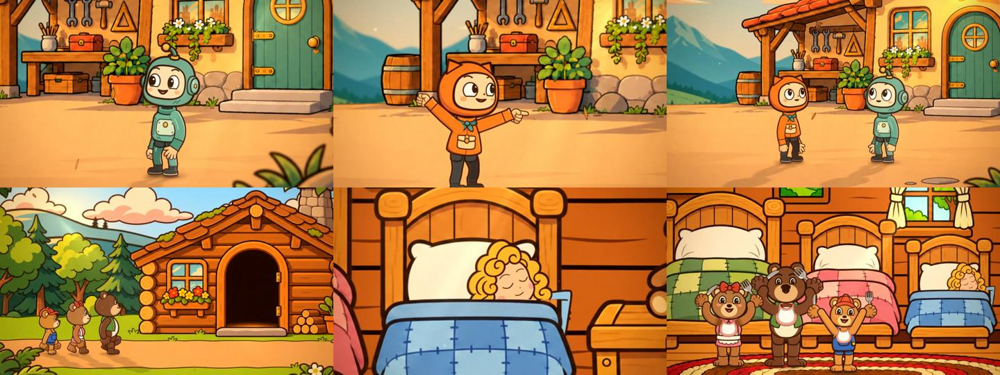

# Cel Studio (CartoonAI)

[English](README.md) · **Español**

Un estudio local de animación 2D donde una IA edita la animación **como datos**. Sin modelos de video, sin difusión, sin generación fotograma a fotograma: la película es un guion compacto y legible que un motor determinista renderiza.



## Qué es

Cel Studio es un estudio local de animación 2D por recortes (marionetas). Los personajes son rigs hechos con piezas de arte reutilizables (vistas de cabeza, torso, manos, botas...), los escenarios son fondos multiplano por capas, y una película es un documento JSON (`script.json`) que dice *quién hace qué y cuándo*. Un renderizador en CPU (Skia) convierte ese documento en fotogramas y en un MP4 mediante FFmpeg.

Se puede manejar de tres maneras: un agente de IA (Claude Code, Codex...) que edita los archivos y llama a la CLI, una persona en el estudio web (disponible en español e inglés, con selector en la cabecera) o tus propios scripts de Python con el DSL de `celstudio/v2/direct.py`.

## Por qué: animación como datos, no como generación

Los modelos generativos de video producen píxeles. Cel Studio produce **instrucciones**.

La película es un guion con esta estructura:

```
biblioteca (personajes, escenarios, utilería)
  -> escenas (un escenario + un reparto)
    -> planos (duración, cámara)
      -> acciones ordenadas (verbos): walk, wave, face, look_at, hop, turn_around, cam, fade_out...
```

```json
{"on": "luma", "do": "walk", "t0": 0.7, "t1": 7.4, "x0": -70, "x1": 482, "step": 56},
{"on": "pip",  "do": "face", "t": 3.1, "name": "surprise"},
{"on": "shot", "do": "cam",  "t": 0, "x": 612, "y": 388, "zoom": 1.04}
```

Un motor determinista lee ese guion y dibuja cada fotograma como función pura de `(film, plano, tiempo)`. Consecuencias:

- **Renderizar y volver a renderizar cuesta cero tokens** y da resultados idénticos, fotograma a fotograma. Ni LLM, ni red, ni modelo en GPU en el camino de render.
- **Los tokens se gastan una vez por recurso reutilizable y una vez por edición, nunca por fotograma.** Una hoja de personaje se genera una vez y se reutiliza en todos los planos de todos los capítulos. Un capítulo son unos miles de líneas de JSON legible, no millones de píxeles de video.
- **Editar es preciso.** «Que papá huela más tiempo» es cambiar unos pocos números en una acción, no una generación nueva que puede cambiarle la cara, el chaleco y el fondo. Los personajes no se desvían porque en cada fotograma es el mismo arte.
- **El trabajo de la IA se puede revisar.** Un guion se compara con diff, se valida (`check()` informa errores con ruta, por ejemplo `shots[2].actions[14]`) y se puede versionar en git.

Frente a la difusión de video: el coste crece con los segundos de video, cada toma es una tirada de dados nueva, los personajes cambian entre clips y corregir un detalle obliga a regenerar todo. Cel Studio cambia la libertad de «puede aparecer cualquier cosa» por control, repetibilidad y coste marginal casi nulo. El precio es que solo se puede lo que expresan los rigs, los verbos y el catálogo de arte (ver [Estado](#estado-y-limitaciones-conocidas)).

## El papel de la IA

La IA no se elimina; se usa donde más aporta y nunca en el bucle de render.

1. **Departamento de arte.** Cada recurso reutilizable se genera **una vez** con un modelo de imágenes: hojas de modelo de personajes, piezas de cabeza y torso, manos (palma y dorso), vistas de perfil, capas de escenario, utilería. En este repositorio las imágenes se produjeron con OpenAI Codex `image_gen`; los prompts se conservan en `work/v3/art` y `work/osos/art`. Nunca por fotograma.
2. **Rigging técnico.** Scripts de Python (`work/v3/prep_*.py`, `build_rig.py`, `work/osos/prep_*.py`, `build_rig_*.py`) recortan el arte en piezas y lo miden (pivotes, colores, placas de cara) para producir los JSON de los rigs.
3. **Director / animador.** Un agente escribe y edita el capítulo (planos, puesta en escena, verbos de actuación, tiempos) como `script.json`, o con el DSL de Python de `celstudio/v2/direct.py` (ver `work/osos/build_film.py`, un ejemplo completo dirigido a partir del encargo de `work/osos/BRIEF.md`).
4. **Crítico.** Un agente mira hojas de contacto (`sheet`) y tiras de movimiento y propone correcciones. Pasar la validación no significa que se vea bien; la revisión visual es parte del ciclo.
5. **Editor.** Una nota se convierte en un cambio pequeño de datos: mover un tiempo, alargar una pausa, cambiar una expresión, mover una clave de cámara. Se vuelve a renderizar y se compara.

El flujo para agentes está descrito en [`skills/cartoon-production/SKILL.md`](skills/cartoon-production/SKILL.md). Agentes como Claude Code o Codex pueden manejar toda la cadena; una persona puede hacer lo mismo a mano en el estudio web.

## Videos de demostración

Ambos son 1920x1080, 24 fps, sin audio, y se hicieron por completo con esta plataforma (arte generado una vez por recurso, todo lo demás son datos y código). Un render completo tarda aproximadamente 4-5 minutos en una CPU.

- [El taller del valle](https://github.com/scorpile/CartoonAI/releases/download/v0.1.0/taller-v16.mp4) (`taller-v16.mp4`, 46,6 s). Película suelta: `projects/taller-v3`.
- [Los tres osos](https://github.com/scorpile/CartoonAI/releases/download/v0.1.0/tres-osos-v2.mp4) (`tres-osos-v2.mp4`, 45,9 s). Capítulo 1 de una serie: `projects/tres-osos`.

Los videos son archivos de la release v0.1.0, no están en git. El arte de personajes y escenarios de `projects/` es el usado en estas demos. Los guiones están en español (el proyecto nació en español); el formato de datos no depende del idioma.

## Estado y limitaciones conocidas

**Alfa, en desarrollo activo.** Funciona de principio a fin (dos películas de demostración), pero es un proyecto joven. Limitaciones, con honestidad:

- **Sin audio ni lip-sync todavía.** Las películas son mudas; el diálogo se conservaría como texto.
- **Los rigs están pensados para bípedos** con las proporciones de los personajes de las demos. Cuadrúpedos, vehículos o anatomías muy distintas requieren trabajo nuevo de rig.
- **La calidad aún está por debajo de la animación profesional de TV.** Nuestra última revisión crítica puntuó el piloto del taller con 6,8/10; las carencias principales son las poses de mano con dedos, las piernas con muslo y pantorrilla separados y la cantidad de arte necesaria por vista.
- **El estudio web está solo en parte probado a mano.** El motor y la capa de datos tienen pruebas automáticas; muchos clics de la interfaz no se han ejercitado a fondo.
- **Solo CPU.** El render usa Skia en CPU con varios procesos. Todavía no hay vía por GPU.
- La preparación de arte por personaje sigue siendo manual y requiere varias hojas generadas (hoja de modelo, piezas, manos, vistas de perfil).

### Se aceptan contribuciones

Por favor, ayuda a mejorar la aplicación. Ideas, de menor a mayor:

- Más verbos de actuación en `celstudio/v2/direct.py` (anticipación, tomas, reacciones, movimiento secundario o de multitudes).
- Vistas de espalda y más ángulos de cabeza; mejores manos (dedos, agarres).
- Cartas de bocas y audio / lip-sync.
- Render por GPU o rutas de CPU más rápidas.
- Un editor de línea de tiempo en el estudio web (hoy el editor de planos es una tabla de acciones ordenadas).
- Más idiomas de interfaz (la interfaz es bilingüe ES/EN; añadir uno es añadir un diccionario).
- Más pruebas (regresión visual, pruebas de interfaz, comprobaciones de determinismo) y mejor documentación.
- Una cadena de arte mejorada: plantillas de prompts, comprobaciones automáticas de las hojas generadas, constructores de rig para otros tipos de cuerpo.
- Documentación y ejemplos en más idiomas.

Ver [CONTRIBUTING.md](CONTRIBUTING.md).

## Características

- **Motor v2** (`celstudio/v2/`, Skia en CPU): extremidades de manguera elástica con IK, con bandas de color y puños medidos del arte; caras paramétricas (ojos, párpados por ojo, cejas, boca, rubor) recortadas por la máscara del rostro; giro de cabeza 2.5D; vistas frontal / tres cuartos / perfil / espalda; muelles para orejas, rizos y antenas; caminata con pies plantados; objetos sostenidos y prendas puestas; capas delanteras ordenadas entre actores.
- **Aspecto:** dibujo a doses con vibración de línea, contorno exterior único, transiciones con estiramiento entre dibujos, escenarios multiplano con paralaje, profundidad de campo, luz de borde y sombra propia, sombras de contacto y proyectada, bloom / corrección de color / viñeta / grano, partículas, rayos de luz, humo.
- **Estructura:** una película suelta, o una **serie** con biblioteca compartida (personajes, escenarios, utilería) y muchos capítulos, cada uno con sus escenas, planos, `film.json` y renders.
- **Estudio web** (bilingüe ES/EN): referencias, guion, personajes, escenarios y utilería, escenas, planos con vista previa, render con progreso, gestión de series y capítulos, búsqueda en la biblioteca y seguimiento de usos.
- **CLI:** `compile`, `frame`, `sheet`, `render`, `new-series`, `new-episode`, `series-convert`.
- **Validación:** `check()` informa errores con ruta dentro del guion antes de renderizar nada.

## Inicio rápido

Requisitos: un Python 3 reciente (desarrollado con 3.13) y [FFmpeg](https://ffmpeg.org/) en el `PATH`. Funciona en Windows, macOS y Linux.

```bash
git clone https://github.com/scorpile/CartoonAI.git
cd CartoonAI
python -m pip install -r requirements.txt    # Pillow, numpy, skia-python
python -m celstudio serve --open             # estudio web en http://127.0.0.1:8768/
```

En Windows también puedes hacer doble clic en `ABRIR_CEL_STUDIO.cmd`. El servidor escucha solo en `127.0.0.1`; si el puerto está ocupado elige otro con `--port`.

### CLI

```bash
# compilar script.json -> film.json (carpeta de película o de capítulo)
python -m celstudio.v2 compile projects/taller-v3
python -m celstudio.v2 compile projects/tres-osos/episodes/ep01

# un fotograma y una hoja de contacto de los planos
python -m celstudio.v2 frame  projects/taller-v3/film.json --shot s07 --time 2.6 --output frame.png
python -m celstudio.v2 sheet  projects/taller-v3/film.json --output sheet.jpg --shot s05 --columns 6

# render (todos los planos, o algunos con --shot; --width, --workers y --crf son opcionales)
python -m celstudio.v2 render projects/taller-v3/film.json --output salida.mp4
python -m celstudio.v2 render projects/tres-osos/episodes/ep01/film.json --output ep01.mp4

# serie y capítulo nuevos
python -m celstudio.v2 new-series mi-serie --title "Mi serie"
python -m celstudio.v2 new-episode mi-serie ep01 --title "Piloto"

# convertir una película suelta en una serie con un capítulo
python -m celstudio.v2 series-convert projects/taller-v3
```

### Reconstruir las demos

Los scripts de dirección escriben el `script.json` y lo compilan; después se renderiza:

```bash
python work/osos/build_film.py      # Los tres osos -> projects/tres-osos/episodes/ep01
python work/v3/build_film.py        # El taller del valle -> projects/taller-v3
python -m celstudio.v2 render projects/tres-osos/episodes/ep01/film.json --output tres-osos.mp4
```

Algunos scripts de preparación de `work/` necesitan `scipy` (`requirements-dev.txt`).

## Estructura del repositorio

```
celstudio/v2/        motor: puppet.py (rigs), anim.py (curvas, IK), stage.py (renderizador), gfx.py, fx.py,
                     project.py (formato del guion, validación, series), direct.py (DSL de Python), api.py (API HTTP), i18n.py
celstudio/           server.py y el punto de entrada de la CLI (python -m celstudio)
web/                 el estudio web (studio.html, studio.css, studio.js)
docs/                guías de formato y motor (español en docs/, inglés en docs/en)
skills/              cartoon-production/SKILL.md: flujo de trabajo para agentes de IA
tests/               suite de pytest
projects/taller-v3/  película suelta «El taller del valle»
projects/tres-osos/  serie «Los tres osos» con el capítulo ep01
work/v3/, work/osos/ preparación de arte (recorte, medición, constructores de rig), scripts de dirección, prompts de arte y material de revisión
```

Los videos renderizados son archivos de release, no están en git.

## Documentación

| Español | English |
|---|---|
| [docs/FORMATO_V2.md](docs/FORMATO_V2.md): `script.json`, `film.json`, series, verbos | [docs/en/FORMAT.md](docs/en/FORMAT.md) |
| [docs/ESTUDIO_V3.md](docs/ESTUDIO_V3.md): motor, estilo, comandos, límites (con el historial completo de cambios) | [docs/en/ENGINE.md](docs/en/ENGINE.md) |
| [skills/cartoon-production/SKILL.md](skills/cartoon-production/SKILL.md): flujo para agentes | igual |
| [CONTRIBUTING.md](CONTRIBUTING.md) | igual |

## Licencia

MIT, ver [LICENSE](LICENSE). El arte de muestra de `projects/` se generó para estas demos con un modelo de imágenes.
