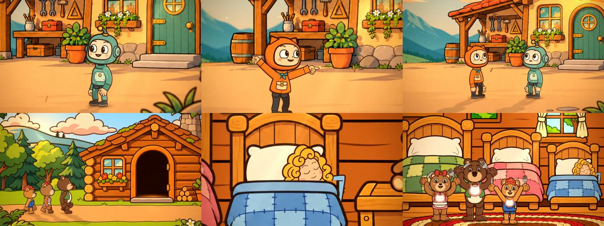

# Cel Studio (CartoonAI)

**English** · [Español](README.es.md)

A local 2D cartoon animation studio where an AI edits animation **as data**. No video model, no diffusion, no frame-by-frame generation: the film is a compact, readable script that a deterministic engine renders.



## What it is

Cel Studio is a local studio for cut-out (puppet) 2D animation. Characters are rigs built from reusable art pieces (head views, torso, hands, boots...), sets are layered multiplane backgrounds, and a film is a JSON document (`script.json`) that says *who does what, when*. A CPU renderer (Skia) turns that document into frames and an MP4 through FFmpeg.

You can drive it three ways: an AI agent (Claude Code, Codex...) editing the files and calling the CLI, a human in the web studio (available in English and Spanish, selector in the header), or your own Python scripts using the DSL in `celstudio/v2/direct.py`.

## Why: animation as data, not as generation

Generative video models produce pixels. Cel Studio produces **instructions**.

The film is a script with this structure:

```
library (characters, sets, props)
  -> scenes (a set + a cast)
    -> shots (duration, camera)
      -> ordered actions (verbs): walk, wave, face, look_at, hop, turn_around, cam, fade_out...
```

```json
{"on": "luma", "do": "walk", "t0": 0.7, "t1": 7.4, "x0": -70, "x1": 482, "step": 56},
{"on": "pip",  "do": "face", "t": 3.1, "name": "surprise"},
{"on": "shot", "do": "cam",  "t": 0, "x": 612, "y": 388, "zoom": 1.04}
```

A deterministic engine reads that script and draws every frame as a pure function of `(film, shot, time)`. Consequences:

- **Rendering and re-rendering cost zero tokens** and give identical results, frame for frame. No LLM, no network, no GPU model in the render path.
- **Tokens are spent once per reusable asset and once per edit, never per frame.** A character sheet is generated once and then reused in every shot of every episode. An episode is a few thousand lines of readable JSON, not millions of pixels of video.
- **Editing is precise.** "Make papa sniff longer" is a change of a few numbers in one action, not a new generation that may change his face, his vest and the background. Characters cannot drift because they are the same art in every frame.
- **The AI's work is reviewable.** A script diffs, validates (`check()` reports errors with a path such as `shots[2].actions[14]`) and can be versioned in git.

Compared with video diffusion: cost grows with seconds of video, each take is a new roll of the dice, characters drift between clips, and fixing one detail means regenerating everything. Cel Studio trades the "anything can appear" freedom of those models for control, repeatability and near-zero marginal cost. The price is that you are limited to what the rigs, verbs and art catalogue can express (see [Status](#status-and-known-limitations)).

## The role of AI

AI is not removed; it is used where it adds the most, and never in the render loop.

1. **Art department.** Each reusable resource is generated **once** with an image model: character model sheets, head and torso parts, hands (palm and back), profile views, set layers, props. In this repo the images were produced with OpenAI Codex `image_gen`; the prompts are kept in `work/v3/art` and `work/osos/art`. Never per frame.
2. **Technical rigging.** Plain Python scripts (`work/v3/prep_*.py`, `build_rig.py`, `work/osos/prep_*.py`, `build_rig_*.py`) cut the art into pieces and measure it (pivots, colours, face plates) to produce the rig JSON files.
3. **Director / animator.** An agent writes and edits the episode (shots, staging, acting verbs, timing) as `script.json`, or with the Python DSL in `celstudio/v2/direct.py` (see `work/osos/build_film.py` for a full example driven by the brief in `work/osos/BRIEF.md`).
4. **Critic.** An agent looks at contact sheets (`sheet`) and motion strips and proposes fixes. Passing validation does not mean it looks good; a visual review is part of the loop.
5. **Editor.** A note becomes a small data change: shift a time, lengthen a pause, swap an expression, move a camera key. Re-render and compare.

The workflow for agents is described in [`skills/cartoon-production/SKILL.md`](skills/cartoon-production/SKILL.md). Agents such as Claude Code, Codex or Claude Desktop can drive the whole pipeline through the built-in **MCP server** (`python -m celstudio.mcp`: read and validate scripts, edit shots with a revision check, look at frames and contact sheets, start renders) or through the CLI; humans can do the same by hand in the web studio. Setup: [docs/en/INSTALL.md](docs/en/INSTALL.md).

## Demo videos

Both are 1920x1080, 24 fps, silent, and were made entirely with this platform (art generated once per resource, everything else is data and code). A full render takes roughly 4-5 minutes on a CPU.

- [The workshop in the valley](https://github.com/scorpile/CartoonAI/releases/download/v0.1.0/taller-v16.mp4) (`taller-v16.mp4`, 46.6 s). Standalone film: `projects/taller-v3`.
- [The three bears](https://github.com/scorpile/CartoonAI/releases/download/v0.1.0/tres-osos-v2.mp4) (`tres-osos-v2.mp4`, 45.9 s). Episode 1 of a series: `projects/tres-osos`.

The videos are release assets (release v0.1.0), not files in git. The character and set art in `projects/` is the art used in these demos. The scripts are in Spanish (the project started in Spanish); the data format is language-neutral.

## Status and known limitations

**Alpha, in active development.** It works end to end (two demo films), but it is a young project. Honest limitations:

- **No audio and no lip-sync yet.** Films are silent; dialogue would be kept as text.
- **Rigs are designed for bipeds** with the proportions of the demo characters. Quadrupeds, vehicles or very different anatomies need new rig work.
- **Quality is still below professional TV animation.** Our own last critical review scored the workshop pilot 6.8/10; the main gaps are hand and finger poses, limbs with separate thigh/shin, and the amount of art needed per view.
- **The web studio is only partly tested by hand.** The engine and data layer have automated tests; many UI clicks have not been exercised thoroughly.
- **CPU only.** Rendering uses Skia on the CPU with several worker processes. No GPU path yet.
- The art pipeline per character is still manual and takes several generated sheets (model sheet, parts, hands, profile views).

### Contributions are welcome

Please help improve the application. Ideas, roughly from small to large:

- More acting verbs in `celstudio/v2/direct.py` (anticipation, takes, reactions, crowd or secondary motion).
- Back views and more head angles; better hands (fingers, grips).
- Mouth charts and audio / lip-sync.
- GPU rendering or faster CPU paths.
- A timeline editor in the web studio (today the shot editor is a table of ordered actions).
- More interface languages (the UI is bilingual ES/EN; adding one means a new dictionary).
- More tests (visual regression, UI tests, determinism checks) and better docs.
- An improved art pipeline: prompt templates, automatic checks of generated sheets, rig builders for other body types.
- Documentation and examples in more languages.

See [CONTRIBUTING.md](CONTRIBUTING.md).

## Features

- **Engine v2** (`celstudio/v2/`, CPU Skia): IK rubber-hose limbs with colour bands and cuffs measured from the art, parametric faces (eyes, per-eye eyelids, brows, mouth, blush) clipped by the face mask, 2.5D head turn, front / three-quarter / profile / back views, springs for ears, curls and antennae, planted-foot walk cycle, held items and worn garments, ordered front layers between actors.
- **Look:** drawing on twos with line boil, a single outer contour, smear transitions between drawings, multiplane sets with parallax, depth of field, rim light and shade, contact and cast shadows, bloom / grade / vignette / grain, particles, light rays, smoke.
- **Structure:** a single film, or a **series** with a shared library (characters, sets, props) and many episodes, each with its own scenes, shots, `film.json` and renders.
- **Web studio** (bilingual ES/EN): references, script, characters, sets and props, scenes, shots with live preview, render with progress, series and episode management, library search and usage tracking.
- **CLI:** `compile`, `frame`, `sheet`, `render`, `new-series`, `new-episode`, `series-convert`.
- **MCP server for AI agents** (`python -m celstudio.mcp`, optional dependency): tools to list projects, read / check / save scripts, search the library, render frames and contact sheets, and start video renders. Works with Claude Code, Codex, Claude Desktop and any MCP client. See [docs/en/INSTALL.md](docs/en/INSTALL.md).
- **Validation:** `check()` reports errors with a path in the script before anything is rendered.

## Quick start

Requirements: Python 3.10+ (developed on 3.13) and [FFmpeg](https://ffmpeg.org/) on your `PATH` (only to render videos). Works on Windows, macOS and Linux.

```bash
git clone https://github.com/scorpile/CartoonAI.git
cd CartoonAI
python -m pip install -r requirements.txt    # Pillow, numpy, skia-python
python -m celstudio serve --open             # web studio at http://127.0.0.1:8768/
```

On Windows you can also double-click `ABRIR_CEL_STUDIO.cmd`. The server listens on `127.0.0.1` only; if the port is busy pick another with `--port`.

**Full installation and agent setup** (FFmpeg per OS, virtual environment, tests, Claude Code / Codex / Claude Desktop configuration): [docs/en/INSTALL.md](docs/en/INSTALL.md).

### CLI

```bash
# compile script.json -> film.json (a film folder, or an episode folder)
python -m celstudio.v2 compile projects/taller-v3
python -m celstudio.v2 compile projects/tres-osos/episodes/ep01

# a single frame, and a contact sheet of the shots
python -m celstudio.v2 frame  projects/taller-v3/film.json --shot s07 --time 2.6 --output frame.png
python -m celstudio.v2 sheet  projects/taller-v3/film.json --output sheet.jpg --shot s05 --columns 6

# render (all shots, or some with --shot; --width, --workers, --crf are optional)
python -m celstudio.v2 render projects/taller-v3/film.json --output out.mp4
python -m celstudio.v2 render projects/tres-osos/episodes/ep01/film.json --output ep01.mp4

# new series and episode
python -m celstudio.v2 new-series my-series --title "My series"
python -m celstudio.v2 new-episode my-series ep01 --title "Pilot"

# turn a standalone film into a series with one episode
python -m celstudio.v2 series-convert projects/taller-v3
```

### Rebuild the demos

The direction scripts write the `script.json`, compile it, and you render afterwards:

```bash
python work/osos/build_film.py      # The three bears -> projects/tres-osos/episodes/ep01
python work/v3/build_film.py        # The workshop in the valley -> projects/taller-v3
python -m celstudio.v2 render projects/tres-osos/episodes/ep01/film.json --output tres-osos.mp4
```

Some preparation scripts in `work/` need `scipy` (`requirements-dev.txt`).

## Repository layout

```
celstudio/v2/        engine: puppet.py (rigs), anim.py (curves, IK), stage.py (renderer), gfx.py, fx.py,
                     project.py (script format, validation, series), direct.py (Python DSL), api.py (HTTP API), i18n.py
celstudio/           server.py and the CLI entry point (python -m celstudio); mcp_server.py + mcp/: MCP server (python -m celstudio.mcp)
web/                 the web studio (studio.html, studio.css, studio.js)
docs/                format and engine guides (English in docs/en, Spanish in docs/)
skills/              cartoon-production/SKILL.md: workflow for AI agents
tests/               pytest suite
projects/taller-v3/  standalone film "The workshop in the valley"
projects/tres-osos/  series "The three bears" with episode ep01
work/v3/, work/osos/ asset preparation (cutting, measuring, rig builders), direction scripts, art prompts and review material
```

Rendered videos are release assets, not stored in git.

## Documentation

| English | Español |
|---|---|
| [docs/en/FORMAT.md](docs/en/FORMAT.md): `script.json`, `film.json`, series, verbs | [docs/FORMATO_V2.md](docs/FORMATO_V2.md) |
| [docs/en/ENGINE.md](docs/en/ENGINE.md): engine concepts, style, commands, limits | [docs/ESTUDIO_V3.md](docs/ESTUDIO_V3.md) (with the full change log) |
| [docs/en/INSTALL.md](docs/en/INSTALL.md): installation, MCP server and agent setup | [docs/INSTALACION.md](docs/INSTALACION.md) |
| [skills/cartoon-production/SKILL.md](skills/cartoon-production/SKILL.md): agent workflow | [SKILL.es.md](skills/cartoon-production/SKILL.es.md) |
| [CONTRIBUTING.md](CONTRIBUTING.md) | same |

## License

MIT, see [LICENSE](LICENSE). The sample art in `projects/` was generated for these demos with an image model.
